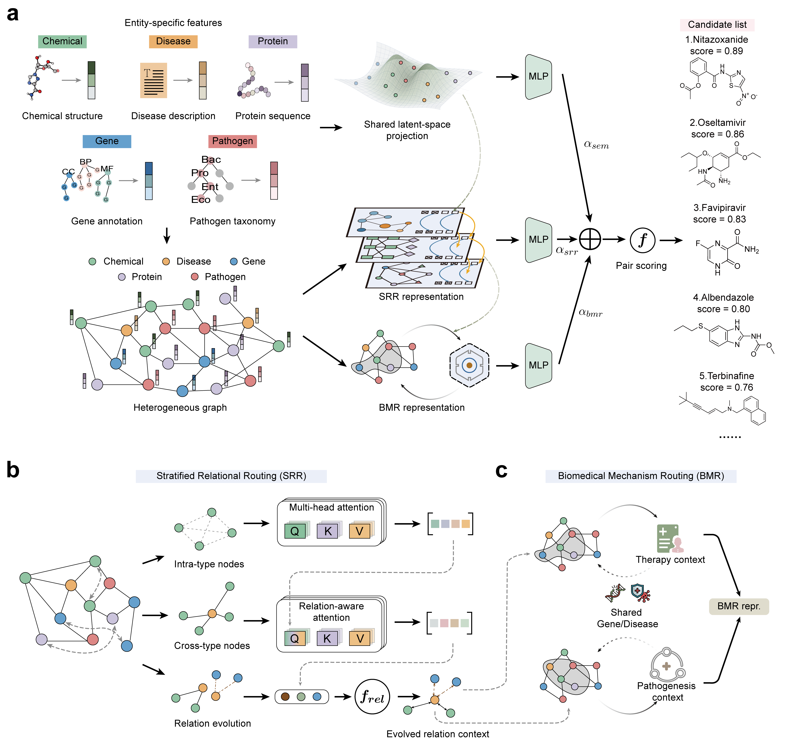

# Overview

- **RAPID** (Rapid Antiviral Prioritization and Iterative Discovery) is an iterative, knowledge-driven discovery engine that closes the loop between relation graph reasoning, explainable mechanistic deduction, and multi-tiered biological validation. 
- **BioRoute**, as a part of RAPID, is a mechanism-inspired dual-router reasoning architecture that decouples semantic and relational topological propagation via *Stratified Relational Routing (SRR)* while isolating biological contexts through *Biomedical Mechanism Routing (BMR)*.

> [!TIP]
> 🚀 **Web Server Available!** 
> We provide the **[RAPID web server](https://lilab-ecust.cn/rapid/)** for online inference.

<p align="center">
  
</p>


## Environment and Dependencies

### Installation

The provided `requirements.txt` is an environment export from the development environment. CUDA, PyTorch, and PyTorch Geometric packages may need to be adapted to the target machine.

```bash
conda create --name bioroute --file requirements.txt
conda activate bioroute
```

### Pretrained Feature Models

Download pretrained models manually from Hugging Face. 

| Feature type | Model | URL |
| --- | --- | --- |
| Protein sequence | ESM-2 (`facebook/esm2_t33_650M_UR50D`) | [Hugging Face](https://huggingface.co/facebook/esm2_t33_650M_UR50D) |
| Disease description text | BioClinicalBERT (`emilyalsentzer/Bio_ClinicalBERT`) | [Hugging Face](https://huggingface.co/emilyalsentzer/Bio_ClinicalBERT) |
| Chemical SMILES | ChemBERTa (`seyonec/ChemBERTa-zinc-base-v1`) | [Hugging Face](https://huggingface.co/seyonec/ChemBERTa-zinc-base-v1) |

## Repository Layout

```text
BioRoute/
├── src/
│   ├── model/                   # Model components: SRR, BMR, decoder
│   ├── utils/                   # Ranking, evaluation, and distributed-training utilities
│   ├── trainer.py               # Training, validation and test evaluation
│   ├── feature_dr_extra.py      # Chemical features: ChemBERTa and Morgan fingerprints
│   ├── feature_di_extra.py      # Disease text features: BioClinicalBERT
│   ├── feature_pr_extra.py      # Protein sequence features: ESM-2
│   ├── feature_ge_extra.py      # Gene GO multi-hot features and GOResMLP encoder
│   └── feature_pa_extra.py      # Pathogen taxonomy multi-hot features
├── script/
│   ├── negative_sampling/       # Random and relay-based negative sampling logiv
│   ├── negative_sampler.py      # Public compatibility entry point
│   ├── train.py                 # Train and evaluate BioRoute
│   └── build_graph.py           # Build the graph and prepare data splits
├── data/                        # Local graph/features directory
├── requirements.txt             # Python environment dependencies
└── README.md                    # Project overview
```
## Cite this work 

## License

This project is licensed under the MIT License. See [LICENSE](LICENSE) for details.
